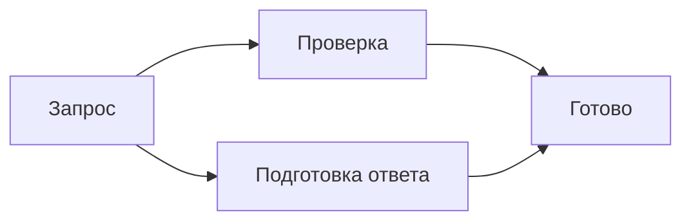
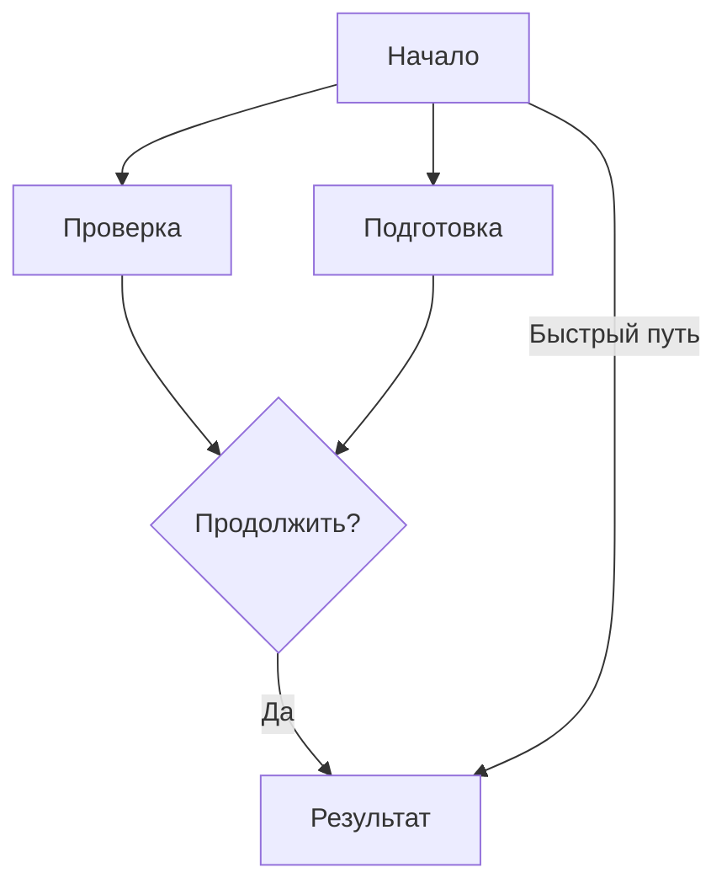
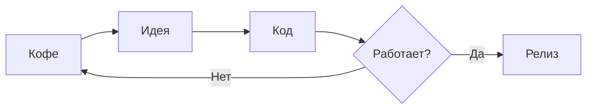

# Прямоугольные маршруты Mermaid

Небольшое ветвление и слияние: линии должны идти по горизонтали и вертикали.

Схема сверху вниз: короткая и длинная ветки, подписи и пропуск уровня.

Цикл со скруглённым ромбом: наконечники касаются контура фигуры.

