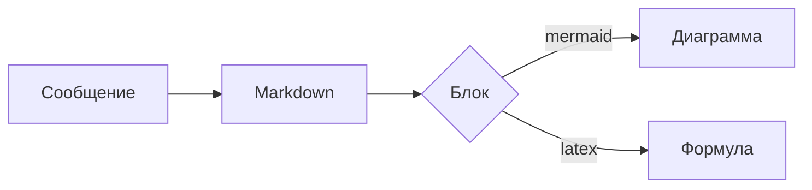

## Mermaid на Rust



## LaTeX на Rust

```latex
\int_0^{\infty} e^{-x^2}\,dx = \frac{\sqrt{\pi}}{2}
```

```tex
\begin{pmatrix} a & b \\ c & d \end{pmatrix}
\begin{pmatrix} x \\ y \end{pmatrix}
= \begin{pmatrix} ax+by \\ cx+dy \end{pmatrix}
```
