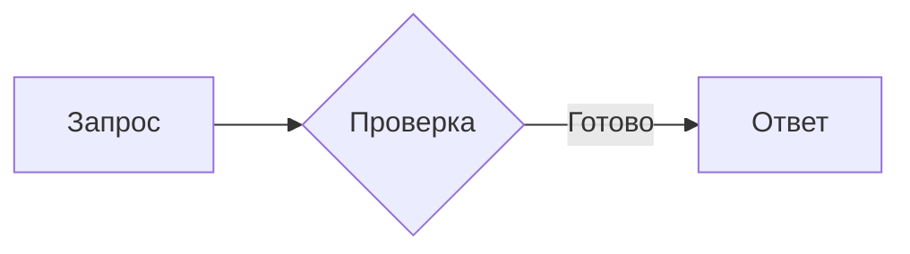

# Процессные рендереры: 29.10.2026

Девять успешных прогонов: три свежих процесса каждого пакета. Источник — только актуальные `*-01..03`; архивные серии не используются.

Первый ответ — медиана процессов. Cached — медиана трёх ответов внутри процесса, затем медиана процессов. Память — медиана выборок idle-фазы внутри процесса, затем медиана процессов. MiB = KiB / 1024.

| Рендерер | Первый / cached, мс | Два view: PSS / RSS, MiB | После последнего close: PSS / RSS, MiB | Sampled peak PSS / RSS, MiB | Node / EOF процессы |
|---|---:|---:|---:|---:|---:|
| Pele + Node | 163.317 / 0.209 | 48.967 / 57.629 | 1.196 / 3.160 | 48.971 / 57.633 | 1 / 0 |
| Rust Mermaid + patch/kurbo | 16.913 / 0.216 | 6.247 / 8.711 | 6.247 / 8.711 | 6.247 / 8.711 | 0 / 0 |
| Rust LaTeX, отдельная формула | 1.761 / 0.211 | 2.869 / 4.520 | 2.873 / 4.523 | 2.873 / 4.523 | 0 / 0 |

Pele и Rust Mermaid получили один и тот же трёхузловой flowchart; LaTeX — отдельную формулу. Память Pele включает Node. После последнего close Node завершается; Rust-процессы остаются живы. После EOF процессов нет.

Первый ответ от запуска процесса: Pele + Node 181.791 мс; Rust Mermaid + patch/kurbo 34.812 мс; Rust LaTeX, отдельная формула 19.564 мс.

Библиотеки: kurbo 0.11.3, latex-rust 2.1.1, mermaid-rs-renderer 0.3.1, pele 1.12.0.

Mermaid patch SHA-256: `e3a2997f65210145ce6af1fea672993dd4c0eda57a307f9cab3553d48a2e7426`.

## Входы и параметры



```latex
\int_0^{\infty} e^{-x^2}\,dx = \frac{\sqrt{\pi}}{2}
```

Тема и настройки, полный SHA каждого executable/source/manifest, per-run результаты, VmHWM по executable и SHA локальных evidence: [report.json](report.json). HOME, XDG paths, PID и машинные абсолютные пути не публикуются.

## Границы измерения

- Только готовое расширение и его наблюдаемые дочерние процессы; Python observer, Cargo, Core, GUI, GPUI/resvg и GPU не входят.
- Записаны отдельные HOME/XDG_CONFIG_HOME/XDG_CACHE_HOME каждого процесса. Директории готовит вызывающий; exporter проверяет различие путей, а не их пустоту перед историческим запуском. Кэш ОС прогрет/неконтролируемый.
- `render_ms` заканчивается timestamp получения ответа reader-потоком. Это не полный цикл и не готовый кадр; cached около 0,2 мс не означает такой throughput instrumented цикла.
- Первая выборка идёт после Popen. Initialization peak и короткие всплески могут быть пропущены. Отдельная settled-память сразу после первого ответа не измерялась.
- Sampled simultaneous peak — нижняя оценка. VmHWM не складывается между PID; VSZ/VmSize не собирался.
- Три процесса не подтверждают p95/p99 и общий speedup сложных диаграмм. Девять cache hits не являются девятью независимыми процессами.
- Сохранённая память после close не доказывает утечку. Равенство SVG внутри повторов проверено; визуальная эквивалентность движков и native proof — отдельная проверка.

Максимальный наблюдённый SwapPss: 0 KiB. Порядок запусков: pele-01, rust-mermaid-01, rust-latex-01, rust-mermaid-02, rust-latex-02, pele-02, rust-latex-03, pele-03, rust-mermaid-03.

## Отдельная сборка Desktop

Commit `5655aba7080e83002d4bdbffb91bb39e936978e7`, desktop-only release, jobs=2, без архива: rebuild + assembly 315.84 с; следующий no-op + assembly 7.87 с. Существующие Cargo/OS caches сохранены. Это не clean build и не before/after сравнение скорости компилятора.
