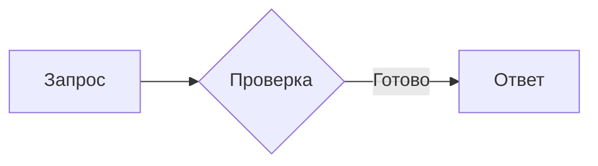
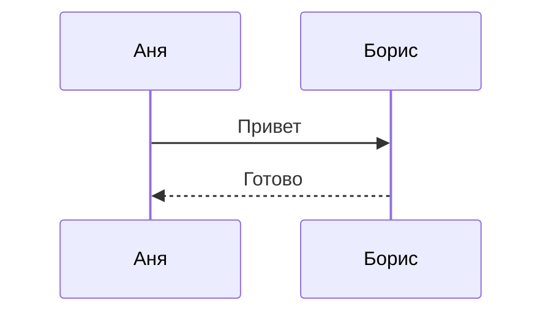

# Диаграммы Mermaid

Самостоятельное процессное расширение для завершённых fenced-блоков
`mermaid`. Pele 1.12.0 превращает исходник в SVG; клиент рисует обычный
публичный `svg` нативно через GPUI/resvg. Браузера, WebView и DOM нет.
Пакет не интерпретирует Markdown и не изменяет исходник ответа.

## Запуск И Проверка

Требуется **Node.js >= 20** в `PATH`. Node входит в требования этого пакета,
не скачивается и не устанавливается при открытии диаграммы. Никакие npm
зависимости, `node_modules`, CDN или сетевые запросы во время рендера не нужны.
Официальный ESM bundle Pele уже находится в `vendor/pele/pele.mjs`.

Из корня Proteus-desktop-extensions:

```bash
cargo test --locked -p extension-mermaid-render
node --test packages/mermaid-render/tests/worker.test.mjs
python3 package.py --package mermaid-render --dev
```

Для отдельного установочного ZIP:

```bash
python3 package.py --package mermaid-render
```

Упаковщик доставляет Rust-бинарник, `worker.mjs`, `svg-theme.mjs`, vendored
bundle и лицензии вместе. Launcher запускает бинарник из каталога пакета.

## Жизненный Цикл И Пределы

Node запускается лениво при первом рендере. Все открытые Mermaid views
одного пакета используют один дочерний процесс, а не процесс на диаграмму
или токен. Закрытие view удаляет его владельца из кеша. После закрытия
последнего view Rust синхронно завершает и ожидает Node; закрытие самого
расширения также освобождает дочерний процесс. Перенос view между окнами
сохраняет его opaque ID и не является закрытием.

Кеш ограничен 8 результатами и 4 МиБ исходников/деревьев; закрытые результаты
без владельцев сразу удаляются. Внутренний кеш ширин текста Pele очищается
после каждого вычисления. Предел исходника — 50 000 байт UTF-8, графа —
500 рёбер, SVG — 1 МиБ; вычисление ожидается не более 5 секунд. V8 old-space
ограничен 96 МиБ (это не предел полного RSS Node). Отрисованный SVG вписывается
в ширину 640 и высоту 4096 логических пикселей с сохранением пропорций.
Внешние изображения и ссылки отключены в официальных `RenderOptions`.
Неподдерживаемый Mermaid или превышение предела возвращают `content_error`:
клиент оставляет доступным оригинальный исходник.

## Тема И SVG

Публичный `Content.context.theme` передаёт реальные цвета клиента:
`foreground`, `background`, `muted`, `border`, `accent`, `danger`, `surface`,
`surface_alt`, а также `font_family` и `font_family_mono`. Цвета задаются как
`#rrggbb` или `#rrggbbaa`. Без темы рендер возвращает адресную ошибку, чтобы
светлая палитра по умолчанию не появлялась поверх тёмного интерфейса.

Pele не принимает palette option: SVG использует публичные `--pele-*`
переменные и приватные aliases `--_fg`, `--_s` и другие. Адаптер разрешает
переменные с вложенными fallback и наследованием, `currentColor`, размер
шрифта и радиусы до передачи в generic SVG host. Замена идёт только в
presentation attributes: текст диаграммы, включая буквальное `var(...)`,
не меняется. Хост не содержит условий по id этого пакета.

Примеры:

````markdown



````

Поддержка синтаксиса определяется Pele, а не полным mermaid.js. API и пределы:
[Pele API](https://pele.run/api),
[совместимость](https://pele.run/compatibility),
[токены темы](https://github.com/obsidianmd/pele/blob/main/src/svg/theme.ts),
[корень SVG](https://github.com/obsidianmd/pele/blob/main/src/svg/root.ts).
Используется `render(source, options)`; DOM `mount()` и roundtrip через AST
не требуются.

## Закреплённый Upstream

`vendor/pele/UPSTREAM.json` содержит URL, версию и SHA-256 архива и файлов.
`vendor/pele/LICENSE` сохраняет полный MIT notice Pele и ISC notice Lucide
из опубликованного архива. Сам адаптер лицензирован GPL-3.0-or-later.

Чтобы воспроизводимо заново получить **ту же** версию без npm:

```bash
python3 packages/mermaid-render/update-vendor.py
```

Скрипт проверяет SHA-256 архива и каждого извлечённого файла до записи.
Для перехода на другую версию нужно явно обновить версию и проверенные хеши
в скрипте и `UPSTREAM.json`, затем повторить JS, wire и native SVG проверки.
